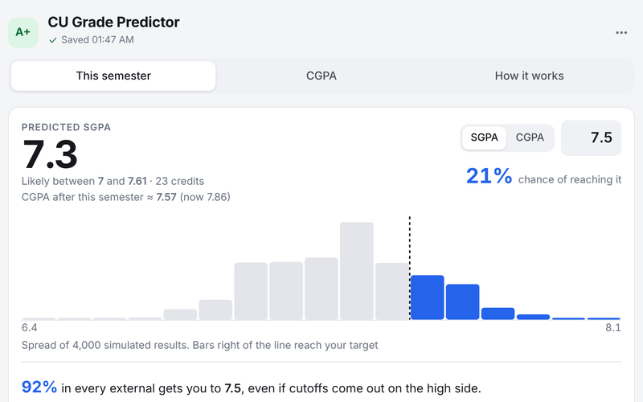
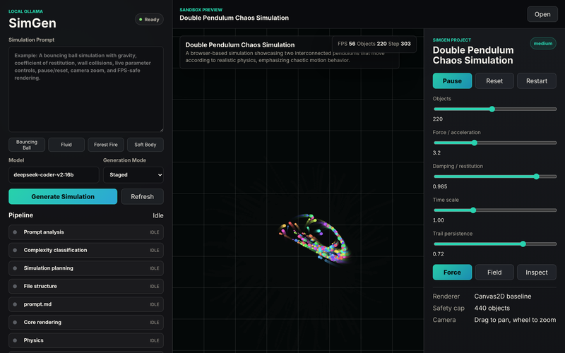

<!--
  PROFILE README  (repo name must equal your GitHub username: SimGittUser/SimGittUser)

  Placeholders to change (or run `python customize.py --help` and let it do the find-and-replace):
    Akshit Singh       display name           (README + assets/header.svg)
    linkedin.com/in/akshit-singh-00b567371   linkedin.com/in/<id>   (just the id)
    akshitsingh1074@gmail.com      you@example.com
    YOUR_PORTFOLIO  https://your-site.com  (delete the badge if you have none)
    https://codeforces.com/profile/codeof_akshit       Codeforces handle
    https://leetcode.com/u/codesof_akshit/     LeetCode username
-->

  

  

 

## Featured projects

<table>
  <tr>
    <td width="33%" valign="top">
      
      <h3>RoadMapper</h3>
      
Tell it what you want to learn and it builds a roadmap from where you stand, with videos from hand-vetted channels. The Machine Learning track places you with concrete questions instead of self-ratings.

      <b>Gemini · YouTube API · Node.js · vanilla JS</b>
    </td>
    <td width="33%" valign="top">
      
      <h3>CU Grade Predictor</h3>
      
Predicts grades, SGPA and CGPA under relative grading, and the minimum external marks needed for a target grade. Cutoffs are treated as uncertain (Monte Carlo, 4,000 runs) and matched 29 of 36 grades from a past batch.

      <b>React · TypeScript · Vite</b>
    </td>
    <td width="33%" valign="top">
      
      <h3>SimGen</h3>
      
Describe a physics simulation in plain English and a local LLM builds it in stages, running in a sandboxed canvas. No cloud, no API key, and a hardware guide for how heavy a simulation your machine can run.

      <b>Ollama · Node.js · Canvas</b>
    </td>
  </tr>
</table>

**More repositories:**
[Reinforcement TrafficLight](https://github.com/SimGittUser?tab=repositories) (PPO signal control) ·
[Snake DQN](https://github.com/SimGittUser/SnakeReinforcement) (Deep Q-learning in PyTorch) ·
[Codeforces Scraper](https://github.com/SimGittUser/CodeForces-Scrapper) (API-based, resumable) ·
[Tic-Tac-Toe](https://github.com/SimGittUser?tab=repositories) (unbeatable minimax engine)

 

## About me

B.Tech student in **AI & ML**. I like taking an idea all the way to something that runs: a trained model, an agent, a tool with a real interface. Most of what I build sits at the point where **machine learning meets something you can click**.

| | |
|---|---|
| **Studying** | B.Tech, Artificial Intelligence & Machine Learning |
| **Research** | 4+ papers in the pipeline: reinforcement learning, explainable AI, applied ML |
| **Building** | Learning-path generator, local-LLM physics sims, RL agents |
| **Practising** | Competitive programming on Codeforces and LeetCode |

 

## Research

Papers I am writing up for publication. Links will go live as each one is out.

| Topic | Area | Status |
|---|---|---|
| Interpreting adaptive traffic-signal control decisions | Reinforcement learning (PPO), SHAP |  |
| Identifying medicinal plants from leaf images | Computer vision, optimisation |  |
| Explaining chess result classification across game phases | Explainable ML, Stockfish and Elo features |  |
| More in the pipeline | |  |

 

## Reinforcement learning, in miniature

A toy version of what my RL projects do: start with random moves, collect reward, and slowly trade exploration for what has been learned.

 

## Tech stack

<b>ML &amp; AI</b>&nbsp;&nbsp;        

<b>Web &amp; tools</b>&nbsp;&nbsp;      

 

## Competitive programming

 

## Contribution snake

<picture>
  <source media="(prefers-color-scheme: dark)" srcset="https://raw.githubusercontent.com/SimGittUser/SimGittUser/output/snake-dark.svg">
  
</picture>

 

